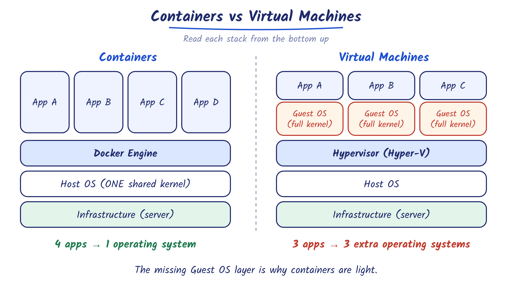
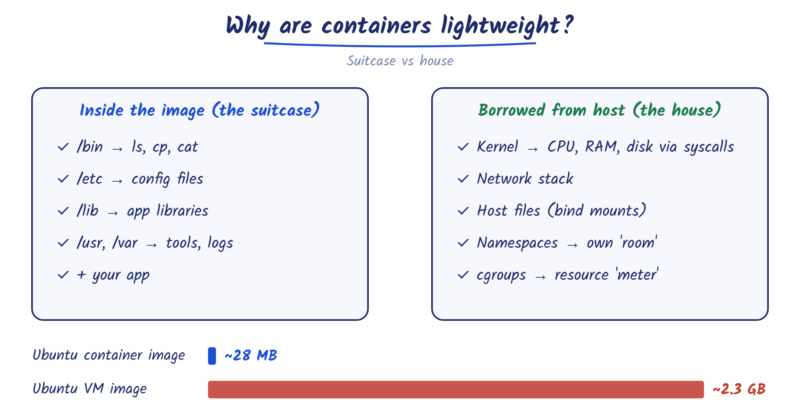
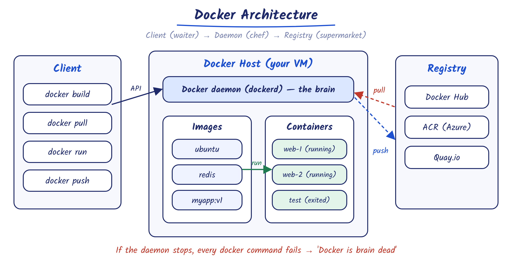
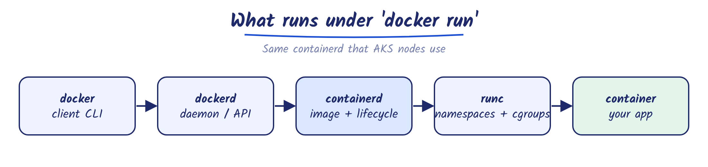
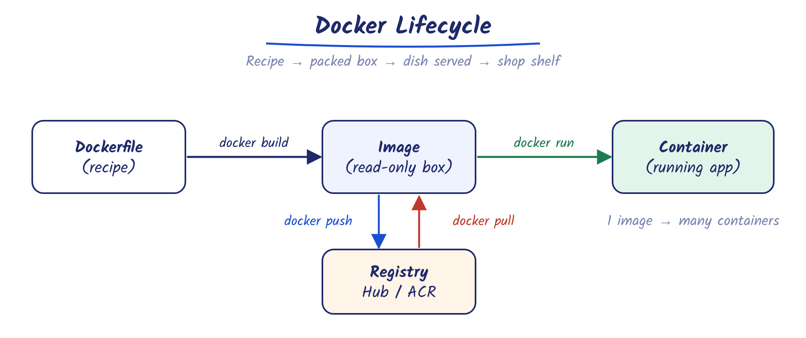
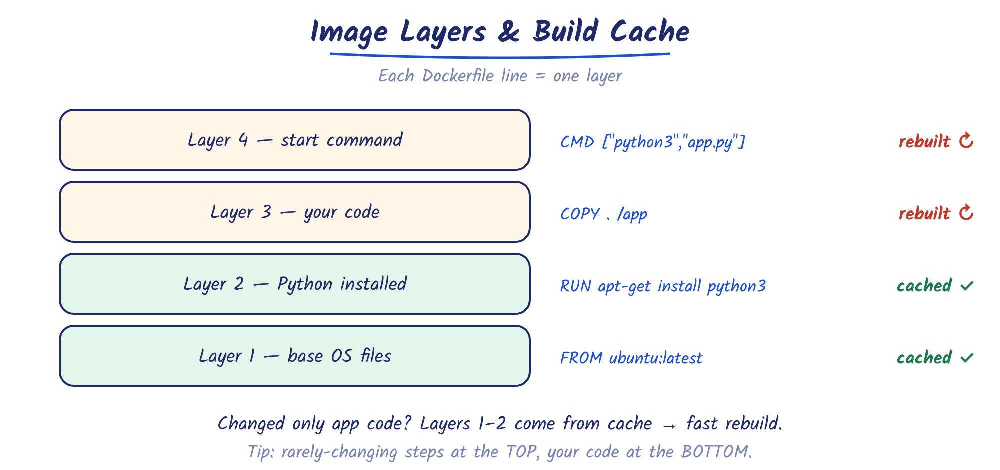
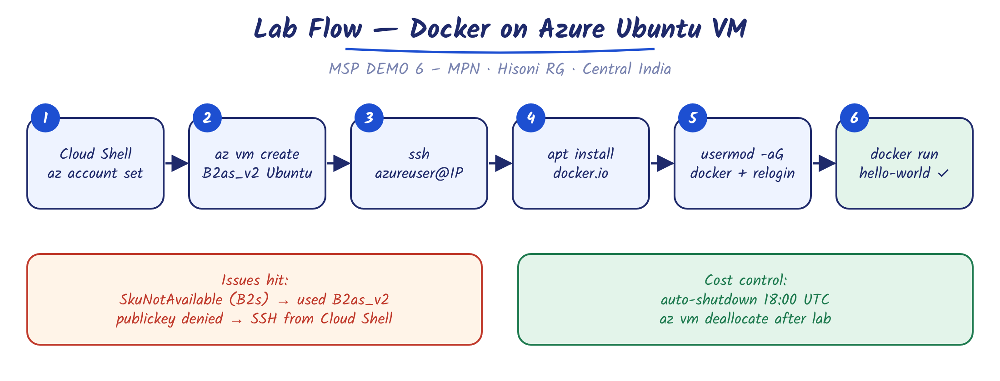
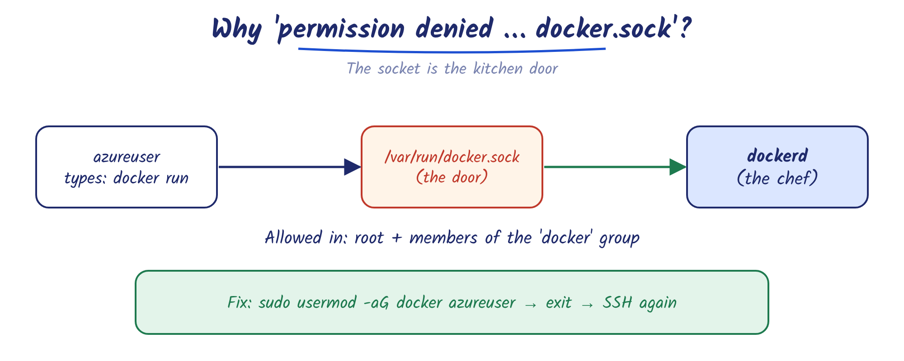

# Docker Basics + Lab 1 — Docker on an Azure Ubuntu VM

> Learning notes · Himanshu Kumar Soni · Nov 2026
> Reference course: [Docker-Zero-to-Hero](https://github.com/iam-veeramalla/Docker-Zero-to-Hero) by Abhishek Veeramalla

**Format of these notes:** every topic has a **Definition** (the textbook/interview answer) first, then **In simple words** (layman explanation), then a diagram.

---

## Contents

1. [Container](#1-container)
2. [Containers vs Virtual Machines](#2-containers-vs-virtual-machines)
3. [Why containers are lightweight](#3-why-containers-are-lightweight)
4. [Docker](#4-docker)
5. [Docker architecture](#5-docker-architecture)
6. [Docker lifecycle](#6-docker-lifecycle)
7. [Docker terminology](#7-docker-terminology)
8. [Image layers](#8-image-layers)
9. [Lab 1 — Docker on Azure Ubuntu VM](#9-lab-1--docker-on-azure-ubuntu-vm)
10. [Issues faced and fixes](#10-issues-faced-and-fixes)
11. [Interview Q&A](#11-interview-qa)
12. [Command cheat sheet](#12-command-cheat-sheet)

---

## 1. Container

**Definition**
A container is a standard unit of software that packages application code together with all its dependencies (libraries, runtime, system tools, settings) so it runs quickly and reliably across different computing environments.

**In simple words**
A container is a **sealed tiffin box**: the food (your app) plus everything needed to eat it (libraries, config) packed together. Wherever you open it — laptop, Azure VM, AKS — it tastes the same.

> ✅ Ends the classic problem: *"It works on my laptop but not on the server."*

---

## 2. Containers vs Virtual Machines

**Definition**
A virtual machine virtualizes **hardware**: each VM runs a full guest operating system on top of a hypervisor. A container virtualizes the **operating system**: containers share the host's kernel and isolate only the application processes.

**In simple words**

- A **VM** is a **separate house** — its own foundation, plumbing, electricity, kitchen.
- A **container** is a **rented room** in an apartment building — it shares the building's utilities and brings only its own furniture.



| Area | Container | Virtual Machine |
|---|---|---|
| OS | Shares host kernel | Own full guest OS |
| Size | MBs (Ubuntu image ~28 MB) | GBs (Ubuntu VM ~2.3 GB) |
| Start time | Seconds or less | Minutes |
| Resource use | Low | High (each VM runs a full OS) |
| Portability | Runs anywhere Docker runs | Tied to a hypervisor |
| Isolation / security | Process-level (weaker) | Hardware-level (stronger) |

> ⭐ **Interview line:** "Containers win on speed, size and portability; VMs win on isolation. In AKS we get both — containers run *inside* VM nodes."

---

## 3. Why containers are lightweight

**Definition**
Containers are lightweight because they share the host OS kernel instead of booting their own, use kernel features (**namespaces** for isolation and **cgroups** for resource limits), and ship as minimal, layered images that contain only what the application needs.

**In simple words**
A container is a **suitcase, not a house**. It carries only the app's belongings and **borrows** the engine (kernel), network and power from the host.



- **Namespaces** = the walls of each room → a container sees only its own processes, network and files.

- **cgroups** = the electricity meter per room → limits how much CPU/RAM each container can use.

> ⚠️ **Correction to the course text:** containers share the host **kernel only**, not its libraries. Libraries (`/lib`) ship *inside* the image. That's why an Ubuntu-based container runs fine on a CentOS host.

> ⚠️ **Trade-off:** all containers share one kernel, so a kernel bug can affect every container on the host.

---

## 4. Docker

**Definition**
Docker is a containerization platform that lets you **build** container images, **run** them as containers, and **push** them to container registries (Docker Hub, Quay.io, Azure Container Registry).

**In simple words**

- **Containerization** = the *idea* of packing a meal into a sealed box.
- **Docker** = the *company* that makes the boxes, packs the food and delivers it.

> Docker is one tool; others follow the same OCI standard — **containerd** (used by AKS nodes) and **Podman**.

---

## 5. Docker architecture

**Definition**
Docker uses a client–server architecture. The **Docker client** (`docker`) sends requests through the Docker REST API to the **Docker daemon** (`dockerd`), which builds, runs and manages images, containers, networks and volumes. Images are stored in and fetched from **registries**.

**In simple words — a restaurant**

| Part | Role | Restaurant |
|---|---|---|
| Client (`docker`) | Takes your command | Waiter |
| Daemon (`dockerd`) | Does all the real work | Chef (the brain) |
| Images | Stored templates | Recipes |
| Containers | Running apps | Dishes being served |
| Registry | Image store | Supermarket |



**What actually runs under `docker run` (seen during install):**



> ⭐ If the daemon stops, **every** Docker command fails — the course's "Docker is brain dead" joke. The daemon is a single point of failure and runs as root.

---

## 6. Docker lifecycle

**Definition**
The Docker lifecycle is: write a **Dockerfile** → `docker build` creates an **image** → `docker run` creates a **container** from the image → `docker push` publishes the image to a **registry**, from where others `docker pull` it.

**In simple words**
Recipe → packed box → dish served → put on the shop shelf for others.



> ⚠️ **Correction:** you push and pull **images**, not containers.
> **Image** = the recipe box (stored). **Container** = the dish being eaten (running). One image → many containers.

**Real-world (Azure):** Dockerfile → `docker build` → test with `docker run` → `docker push` to **ACR** → **AKS** pulls and runs it as pods.

---

## 7. Docker terminology

| Term | Definition | In simple words |
|---|---|---|
| **Docker daemon** (`dockerd`) | Background service that listens for Docker API requests and manages images, containers, networks, volumes | The chef |

| **Docker client** (`docker`) | CLI that sends commands to the daemon via the Docker API; can talk to more than one daemon | The waiter |
| **Docker Desktop** | GUI app for Windows/Mac/Linux bundling daemon, client, Compose, Kubernetes, credential helper | All-in-one starter kit (paid for large companies) |

| **Registry** | Storage and distribution service for images; Docker Hub is the default | Supermarket shelf |
| **Dockerfile** | Text file with step-by-step instructions to build an image | Written recipe |

| **Image** | Read-only template, made of layers, used to create containers | Sealed recipe box |
| **Container** | Runnable instance of an image | The dish being served |

| **Volume** | Storage that survives container deletion | A locker outside the room |
| **Network** | How containers talk to each other and the outside | Corridors between rooms |

---

## 8. Image layers

**Definition**
Every instruction in a Dockerfile creates a read-only **layer**. Layers are cached and shared between images; on rebuild, only changed layers (and those after them) are rebuilt.

**In simple words**
Like stacking plates. If only the top plate changes, you don't re-wash the whole stack.



**Example Dockerfile (Python Hello World):**

```dockerfile
# Base image
FROM ubuntu:latest
# Working folder inside the container
WORKDIR /app
# Copy app files into /app
COPY . /app
# Install Python
RUN apt-get update && apt-get install -y python3
# Environment variable
ENV NAME=World
# Command to run when the container starts
CMD ["python3", "app.py"]
```

> ⭐ **Best practice:** put rarely changing steps (package installs) at the **top**, frequently changing steps (your code) at the **bottom**.

---

## 9. Lab 1 — Docker on Azure Ubuntu VM

**Goal:** create an Ubuntu VM in my Azure test lab, install Docker, and run the first container.

| Item | Value |
|---|---|
| Subscription | MSP DEMO 6 – MPN |
| Resource group | Hisoni |
| Region | Central India |
| VM | docker-lab-vm · Ubuntu 22.04 · Standard_B2as_v2 (2 vCPU, 8 GB) |
| Docker | 29.1.3 (docker.io package) |

> **Why not the existing AVD-VM?** It runs **Windows Server 2025**. Docker there runs **Windows containers only**, so `FROM ubuntu` images from the course would fail. AKS nodes are Linux too, so a Linux VM matches real work.



### Step 1 — Select the subscription (Cloud Shell)

```bash
# Point Cloud Shell to the lab subscription
az account set --subscription "MSP DEMO 6 – MPN"
# Confirm the active subscription
az account show --query name -o tsv
```

**Why:** every `az` command runs against the active subscription. Confirming it avoids creating resources in a client subscription by mistake — important in an MSP / Lighthouse setup.

### Step 2 — Create the VM

```bash
# Create Ubuntu VM with SSH key login
az vm create --resource-group Hisoni --name docker-lab-vm --location centralindia --image Ubuntu2204 --size Standard_B2as_v2 --admin-username azureuser --generate-ssh-keys --public-ip-sku Standard
```

**Why:** one command creates the VM plus NIC, NSG, public IP, and an SSH key pair (stored in Cloud Shell `~/.ssh`). Result: public IP `20.207.194.43`, private IP `192.168.1.4`.

### Step 3 — Set auto-shutdown

```bash
# Auto-shutdown daily at 18:00 UTC (11:30 PM IST)
az vm auto-shutdown --resource-group Hisoni --name docker-lab-vm --time 1800
```

**Why:** stops compute billing if I forget to stop the lab VM.

### Step 4 — Connect over SSH

```bash
# Connect from Cloud Shell (where the key lives)
ssh azureuser@20.207.194.43
```

**Why:** SSH is the standard secure remote shell for Linux. The private key is in Cloud Shell, so connect from there (or add the laptop's key — see Issues).

### Step 5 — Install Docker

```bash
# Refresh the package list
sudo apt update
# Install Docker (daemon + client + containerd + runc)
sudo apt install docker.io -y
```

**Why:** `apt update` makes sure the latest package versions are known. `docker.io` installs `dockerd`, the `docker` CLI, **containerd** and **runc**, and creates the `docker` Linux group.

### Step 6 — Verify the daemon

```bash
# Check the daemon is "active (running)" — press q to exit
sudo systemctl status docker
# Start now and on every boot
sudo systemctl enable --now docker
```

**Why:** the daemon is the brain; no daemon = no Docker. `enable` makes it survive VM reboots.
*Note:* the log line `Deleting nftables rules … exit status 1` is `level=info` — harmless on a fresh VM.

### Step 7 — Give the user Docker access

```bash
# Add azureuser to the docker group
sudo usermod -aG docker azureuser
# Log out so the new group applies, then SSH back in
exit
```

**Why:** the client talks to the daemon through `/var/run/docker.sock`. Only **root** and the **docker group** may use it. `-a` = append (without it, the user is removed from other groups).



> ⚠️ **Security:** docker group membership = root-level control of the host. Add only trusted users.

### Step 8 — Run the first container

```bash
# Pull (if needed) and run the test image
docker run hello-world
```

**What happened:**

1. Client → daemon
2. Image not found locally → **pulled from Docker Hub** (amd64)

3. Daemon created a container → it printed **"Hello from Docker!"**
4. Container **exited** (its only job was to print)

### Step 9 — Inspect images and containers

```bash
# List local images
docker images
# List running containers
docker ps
# List all containers, including stopped
docker ps -a
```

**Observed output explained:**

| Field | Value | Meaning |
|---|---|---|
| Image size | 25.9 kB disk / 9.49 kB download | Tiny image: one small program only |
| `U` (In Use) | hello-world | A container was created from it |
| STATUS | `Exited (0)` | Finished successfully (non-zero = error) |
| NAMES | `objective_black` | Random name — set your own with `--name` |

> ⭐ A container lives only as long as its **main process**.

### Step 10 — Stop paying when done

```bash
# Stop compute billing
az vm deallocate --resource-group Hisoni --name docker-lab-vm
# Start again next time
az vm start --resource-group Hisoni --name docker-lab-vm
```

---

## 10. Issues faced and fixes

| # | Error | Cause | Fix |
|---|---|---|---|
| 1 | `SkuNotAvailable` for Standard_B2s | No capacity in Central India | Used `Standard_B2as_v2`; check sizes with `az vm list-skus --location centralindia --size Standard_B` |
| 2 | `Permission denied (publickey)` | SSH key was created in Cloud Shell, not on the laptop | SSH from Cloud Shell, or add laptop key: `az vm user update --ssh-key-value "<pubkey>"` |
| 3 | `permission denied … docker.sock` | User not in `docker` group | `sudo usermod -aG docker azureuser` → re-login |
| 4 | `user 'Hisoni' does not exist` | Used the **resource group** name as a Linux user | Use `azureuser` / `$USER`; check with `whoami` |

| 5 | `apt` commands on Windows VM | AVD-VM is Windows Server | Built a separate Ubuntu VM |
| 6 | `docker run hello-world~` | Typo (`~`) | Image names must be exact |

---

## 11. Interview Q&A

1. **What is a container?** App + dependencies packaged to run the same anywhere, sharing the host kernel.

2. **Why are containers lightweight?** No guest OS; namespaces + cgroups for isolation; minimal layered images.
3. **Container vs VM?** Containers: faster, smaller, portable. VMs: stronger isolation.

4. **What is the Docker daemon?** `dockerd` — background service that builds/runs/manages containers; the client only sends API calls.
5. **Image vs container?** Image = read-only template; container = running instance of it.

6. **What happens on `docker run hello-world`?** Client → daemon → pull from registry if missing → create container → run → exit.
7. **Why is the docker group sensitive?** It gives root-equivalent control of the host.

8. **What runtime does AKS use?** containerd. Docker-built images work because both follow the OCI standard.
9. **Linux image on a Windows Docker host?** Won't run natively — needs a Linux kernel (WSL2/Hyper-V VM).

---

## 12. Command cheat sheet

| Command | Purpose |
|---|---|
| `docker --version` | Show installed version |
| `docker run <image>` | Pull (if needed) and start a container |
| `docker run -it ubuntu bash` | Interactive shell inside a container |
| `docker run -d --name web nginx` | Run in background with a name |
| `docker images` | List local images |
| `docker ps` / `docker ps -a` | Running / all containers |
| `docker build -t <name>:<tag> .` | Build image from Dockerfile |
| `docker push <image>` | Upload image to registry |
| `docker pull <image>` | Download image from registry |
| `docker login` | Log in to Docker Hub (use an access token) |
| `docker rm <id>` | Remove a stopped container |
| `docker container prune` | Remove all stopped containers |
| `sudo systemctl status docker` | Check daemon |
| `sudo usermod -aG docker $USER` | Allow a user to run Docker |

---

### ✅ Next steps

- [ ] `docker run -it ubuntu bash` — explore inside a container
- [ ] Build the first Dockerfile (Python Hello World) and push to this repo
- [ ] Multi-stage build (golang example)
- [ ] Push an image to **Azure Container Registry**

- [ ] Deploy that image to **AKS**
