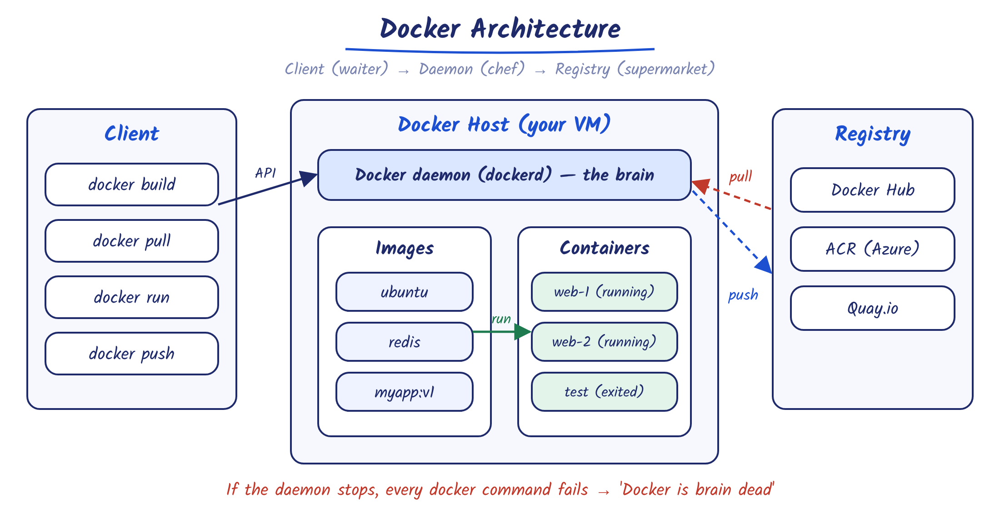

# Docker Learning Notes 🐳

My hands-on notes and labs while learning Docker from zero to hero, practiced on an Azure Ubuntu VM — as a step toward AKS.

Each topic is written as **Definition → In simple words → Diagram**, and each lab command comes with **why** it is used.

## Notes

| # | Topic | What's inside |
|---|---|---|
| 01 | [Docker Basics + Lab 1](Day-1/01-docker-basics.md) | Containers vs VMs, why lightweight, architecture, lifecycle, layers, Docker install on Azure VM, issues & fixes, interview Q&A |

## Lab setup

| Item | Value |
|---|---|
| Cloud | Microsoft Azure (Central India) |
| VM | Ubuntu 22.04 · Standard_B2as_v2 |
| Docker | 29.1.3 (docker.io) |

## Reference

- [Docker-Zero-to-Hero](https://github.com/iam-veeramalla/Docker-Zero-to-Hero) by Abhishek Veeramalla
